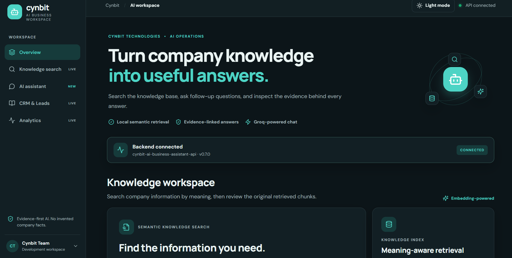
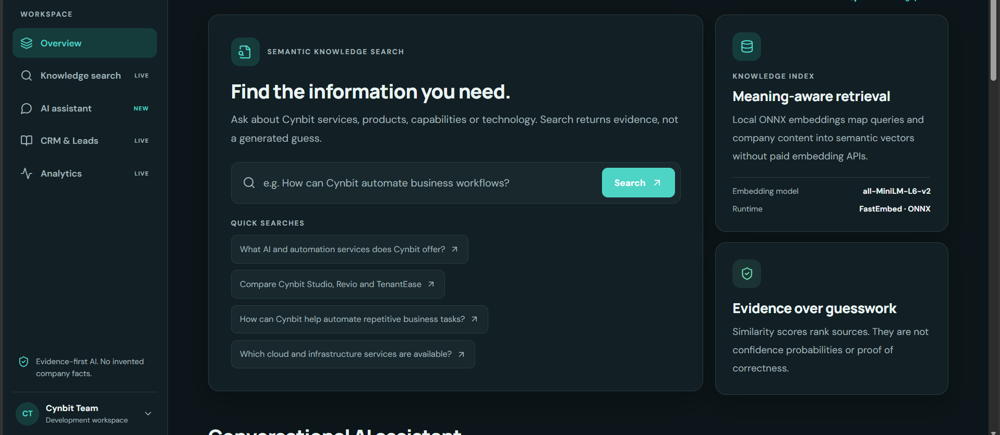
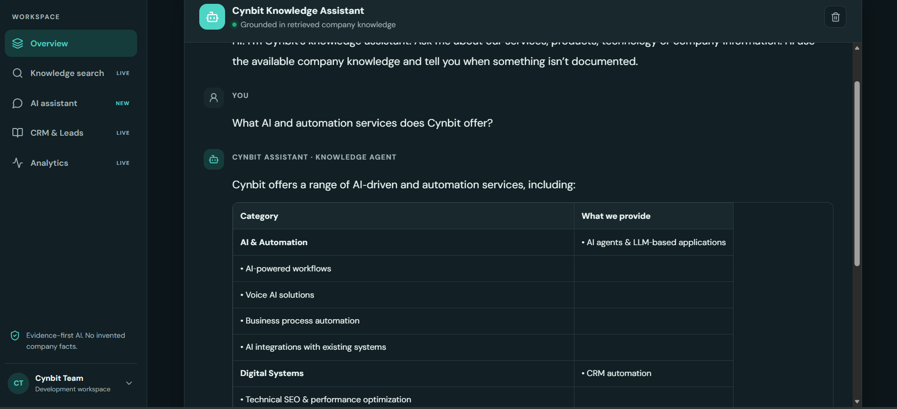
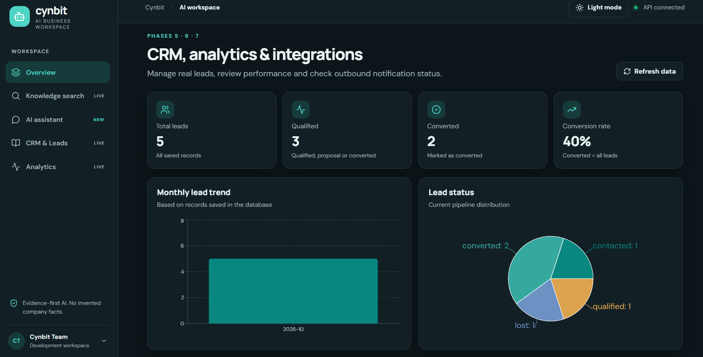
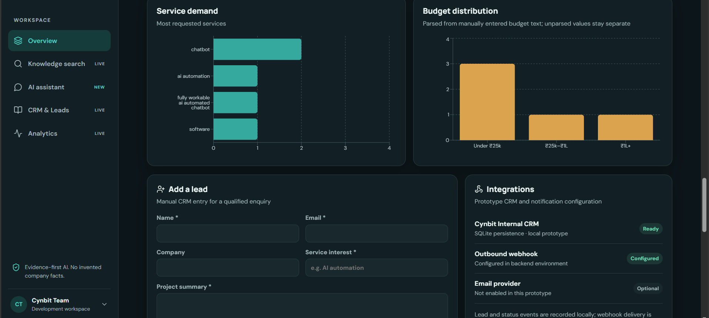
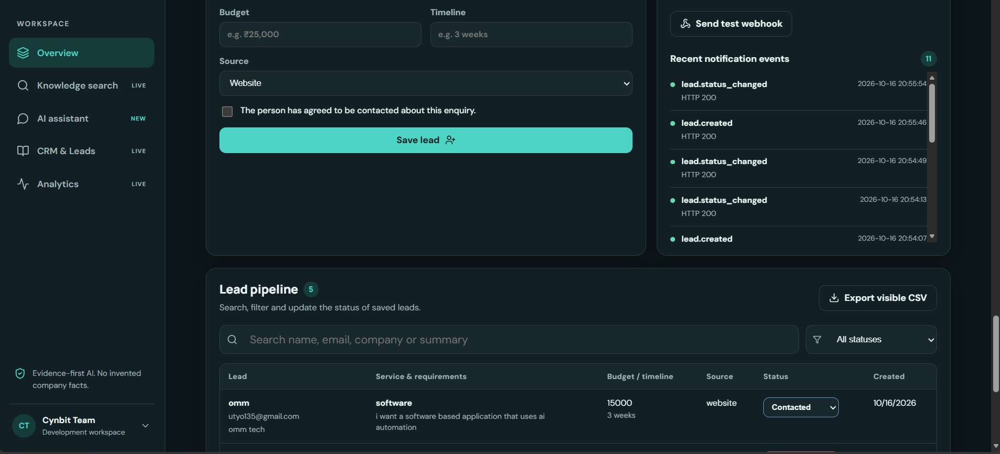
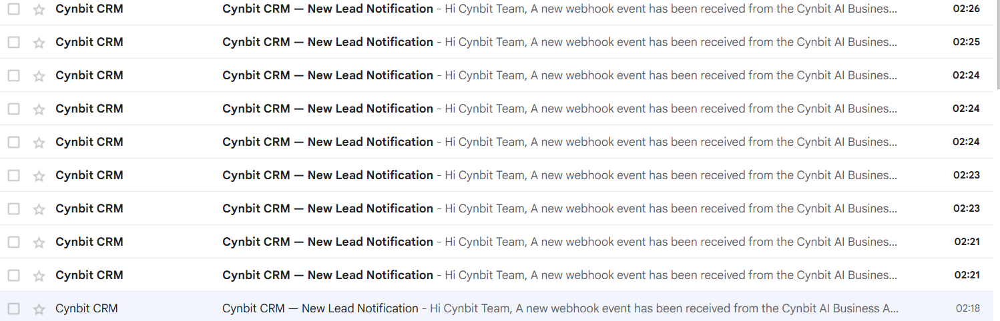

# Cynbit AI Business Assistant

An AI-powered business workspace for Cynbit that combines company knowledge search, evidence-grounded chat, lead management, CRM analytics, and webhook-based notifications.

**Stack:** React, TypeScript, Vite, FastAPI, Python, FastEmbed/ONNX, Groq (optional for chat), SQLite, Recharts, Pipedream, and Gmail.

> **Status:** Development prototype. Knowledge search, the assistant UI, CRM dashboard, SQLite lead storage, analytics, and the Pipedream/Gmail test-notification workflow have been exercised during development. Production use still requires deployment hardening, persistent hosted storage, access controls, monitoring, and backups.


## 🚀 Live Demo

**[Open Cynbit Business Assistant](https://cynbit-business-assistant.vercel.app/)** · **[GitHub Repository](https://github.com/Shivendra1230/Cynbit-Business-Assistant)**

Cynbit Business Assistant is a **working prototype / MVP** that demonstrates semantic company-knowledge retrieval, evidence-aware AI chat, CRM-style lead management, analytics, and outbound webhook integration.

## 📸 Product Screenshots

### 1. Dashboard overview


### 2. Semantic knowledge search


### 3. AI assistant conversation


### 4. CRM and analytics overview


### 5. Budget distribution and integrations


### 6. Lead capture and pipeline


### 7. Email notification proof


The screenshot shows repeated “Cynbit CRM — New Lead Notification” emails, providing visual evidence that webhook-triggered email notifications were received during testing.

## 🧰 Technology Stack

- **Frontend:** React, TypeScript, Vite
- **Backend:** FastAPI
- **Semantic retrieval:** FastEmbed with ONNX runtime
- **Conversational AI:** Groq API (when configured)
- **Prototype data storage:** SQLite
- **Analytics:** Recharts
- **Deployment:** Vercel (frontend) and Render (backend)

> **Prototype note:** This project demonstrates an end-to-end working prototype. Before production use, prioritize authentication and role-based access, managed persistent database storage, secrets management, monitoring, backups, and systematic AI-quality evaluation.


## Contents

- [Features](#features)
- [Architecture](#architecture)
- [Technology stack](#technology-stack)
- [Repository layout](#repository-layout)
- [Prerequisites](#prerequisites)
- [Local setup](#local-setup)
- [Environment variables](#environment-variables)
- [Run locally](#run-locally)
- [Knowledge retrieval and chat](#knowledge-retrieval-and-chat)
- [CRM and analytics](#crm-and-analytics)
- [Webhook and email notifications](#webhook-and-email-notifications)
- [API documentation](#api-documentation)
- [Testing](#testing)
- [Deployment](#deployment)
- [Troubleshooting](#troubleshooting)
- [Production checklist](#production-checklist)
- [Roadmap](#roadmap)

## Features

### Company knowledge workspace
- Semantic search over Cynbit company knowledge.
- Evidence/results that users can inspect instead of relying only on generated text.
- Knowledge ingestion and index statistics through the backend API.
- Local FastEmbed/ONNX embeddings, avoiding a PyTorch dependency for semantic retrieval.

The seeded knowledge covers Cynbit's company overview, AI and automation services, software engineering, cloud infrastructure, digital systems, Cynbit Studio, Revio, TenantEase, BitElevate, technology stack, and contact information.

### Conversational AI assistant
- Chat UI with follow-up messages and conversation history.
- Company-specific answers should be grounded in retrieved Cynbit information.
- Missing details such as prices, timelines, guarantees, or policies should be described as undocumented rather than invented.
- Groq can provide LLM responses when `GROQ_API_KEY` is configured.

### CRM and lead operations
- Create leads with name, email, company, service interest, project summary, budget, timeline, source, and consent to contact.
- Store leads in SQLite.
- Search and filter the lead pipeline.
- Update lead status: `new`, `qualified`, `contacted`, `proposal`, `converted`, or `lost`.
- Export visible lead records to CSV.
- Dashboard metrics include total leads, qualified leads, converted leads, conversion rate, monthly lead trend, status breakdown, service demand, and budget distribution.

### Integrations
- Optional outbound webhook configured with `CYNBIT_WEBHOOK_URL`.
- Integration status and recent notification events shown in the dashboard.
- A **Send test webhook** action to validate the webhook independently of creating a lead.
- Pipedream can receive events and run a Gmail **Send Email** action. The test workflow successfully delivered an integration-test email during development.

### UI
- React + TypeScript single-page application built with Vite.
- Dark and light theme styling.
- Responsive dashboard and Recharts visualizations.
- Loading, success, error, and API status feedback.

## Architecture

```text
React + TypeScript + Vite
  ├── Overview
  ├── Knowledge Search
  ├── AI Assistant
  └── CRM + Analytics + Integrations
                │ HTTP / JSON
                ▼
             FastAPI
  ├── Health and configuration
  ├── Knowledge ingestion and semantic search
  ├── Evidence-grounded chat
  ├── Lead operations and analytics
  └── Outbound webhook + event logging
        │                │
        ▼                ▼
 FastEmbed / ONNX      SQLite
 Local embeddings     Local CRM records
        │
        └── Chat context ──► Groq API (optional)

FastAPI webhook ──► Pipedream HTTP trigger ──► Gmail Send Email
```

**Important:** Semantic similarity is a ranking signal, not a probability of correctness. Grounding, source review, and clear fallback behavior are still necessary.

## Technology stack

| Area | Technology |
|---|---|
| Frontend | React, TypeScript, Vite |
| Styling | CSS and theme variables |
| Charts | Recharts |
| Icons | Lucide React |
| Backend | Python, FastAPI, Pydantic |
| Server | Uvicorn |
| Embeddings | FastEmbed with ONNX runtime |
| Chat model | Groq API (optional) |
| Local database | SQLite |
| Webhook automation | Pipedream |
| Email action | Gmail via Pipedream |
| Frontend hosting | Vercel-compatible Vite build |
| API docs | FastAPI Swagger UI / OpenAPI |

## Repository layout

The exact filenames can vary between revisions. This is a logical guide; synchronize it with the actual repository before publishing.

```text
cynbit-ai-business-assistant/
├── frontend/
│   ├── src/
│   │   ├── api.ts
│   │   ├── Operations.tsx
│   │   ├── Operations.css
│   │   └── ...                 # Overview, search, chat, shared UI
│   ├── package.json
│   ├── index.html
│   └── vite.config.ts
├── backend/
│   ├── app/
│   │   ├── main.py             # FastAPI application/routes
│   │   ├── config.py           # Settings/environment
│   │   ├── knowledge.py        # Semantic index and seed documents
│   │   ├── schemas.py          # Pydantic models
│   │   └── ...                 # CRM, chat, integrations
│   ├── requirements.txt
│   ├── .env                    # Local secrets; do not commit
│   └── data/
│       └── leads.sqlite3       # Configurable SQLite path
├── .gitignore
└── README.md
```

## Prerequisites

- Python 3.11+ (use a version compatible with the installed backend dependencies).
- Node.js LTS and npm.
- Git.
- Groq API key if you want LLM-backed chat.
- Pipedream account and connected Gmail account if email notifications are required.

The embedding model may need to download on first startup, so the initial run can take longer and needs internet access.

## Local setup

### 1. Clone the repository

```bash
git clone <YOUR_GITHUB_REPOSITORY_URL>
cd cynbit-ai-business-assistant
```

Replace the placeholder with the actual GitHub URL.

### 2. Create a Python environment

**Windows PowerShell with Conda:**

```powershell
conda create -n cynbit python=3.11 -y
conda activate cynbit
```

If the environment already exists, activate it instead of recreating it.

**Alternative with `venv`:**

```powershell
py -3.11 -m venv .venv
.\.venv\Scripts\Activate.ps1
```

### 3. Install backend dependencies

```powershell
cd backend
python -m pip install --upgrade pip
pip install -r requirements.txt
```

Make sure `backend/requirements.txt` matches the imports used by the current code. The semantic retrieval implementation uses FastEmbed/ONNX; do not add PyTorch-based Sentence Transformers unless the project intentionally changes its embedding implementation.

### 4. Configure `backend/.env`

Create `backend/.env`:

```dotenv
CORS_ORIGINS=http://localhost:5173,http://127.0.0.1:5173
CYNBIT_LEADS_DB=./data/leads.sqlite3
CYNBIT_WEBHOOK_URL=
GROQ_API_KEY=
GROQ_MODEL=llama-3.3-70b-versatile
```

- `CORS_ORIGINS`: trusted frontend origins allowed by the API.
- `CYNBIT_LEADS_DB`: local SQLite file path.
- `CYNBIT_WEBHOOK_URL`: optional Pipedream trigger URL.
- `GROQ_API_KEY`: optional key for Groq-backed chat.
- `GROQ_MODEL`: model identifier, if supported by the current settings implementation.

**Configuration caveat:** Confirm exact names in `backend/app/config.py` and the current backend source. If your version uses a different CORS or model variable name, follow the code. Do not commit `.env` or paste secrets into source code.

Create the data directory if needed:

```powershell
New-Item -ItemType Directory -Force .\data
```

### 5. Start the backend

From `backend/`:

```powershell
uvicorn app.main:app --reload --host 127.0.0.1 --port 8000
```

Useful URLs:

- API root: <http://127.0.0.1:8000/>
- Health check: <http://127.0.0.1:8000/health>
- Interactive docs: <http://127.0.0.1:8000/docs>
- OpenAPI schema: <http://127.0.0.1:8000/openapi.json>

Keep this terminal running.

### 6. Configure and start the frontend

Open a second terminal:

```powershell
cd frontend
npm install
```

If the frontend API client expects a Vite environment variable, create `frontend/.env.local`:

```dotenv
VITE_API_BASE_URL=http://127.0.0.1:8000
```

The variable name must match the actual implementation in `frontend/src/api.ts`. **Never put `GROQ_API_KEY` or other server-side secrets in a `VITE_*` variable**, because Vite exposes those values to browser code.

Start Vite:

```powershell
npm run dev
```

Open the URL printed in the terminal, usually <http://localhost:5173/>.

### 7. First-run verification

- Check `/health`.
- Check `/api/knowledge/stats` and perform a knowledge search.
- Ask the assistant a question about a documented Cynbit service and inspect the evidence.
- Create a test lead using test data and explicit consent.
- Update its status and confirm analytics refresh.
- If a webhook is configured, use **Send test webhook** and verify the Pipedream event and Gmail delivery.

## Environment variables

| Variable | Required? | Purpose |
|---|---|---|
| `CORS_ORIGINS` | For configured deployments | Comma-separated allowed frontend origins; confirm the exact setting name in `config.py` |
| `CYNBIT_LEADS_DB` | Recommended | SQLite database path |
| `CYNBIT_WEBHOOK_URL` | Optional | Outbound HTTP webhook destination |
| `GROQ_API_KEY` | Optional for search; needed for Groq chat | Secret key for the LLM provider |
| `GROQ_MODEL` | Optional | Chat model identifier if supported by this revision |
| `VITE_API_BASE_URL` | Usually needed for separate frontend hosting | Public backend URL; exact variable name must match `frontend/src/api.ts` |

Environment variable names and defaults must match the checked-out version of the code. Keep API keys, webhook URLs, database files, and personal lead data out of Git.

## Run locally

**Terminal 1 — backend**

```powershell
conda activate cynbit
cd path\to\cynbit-ai-business-assistant\backend
uvicorn app.main:app --reload --host 127.0.0.1 --port 8000
```

**Terminal 2 — frontend**

```powershell
cd path\to\cynbit-ai-business-assistant\frontend
npm run dev
```

Build the frontend for production from `frontend/`:

```powershell
npm run build
npm run preview
```

The Vite production output is normally written to `frontend/dist/`. Run `npm run` to see the scripts defined in the current `package.json`.

## Knowledge retrieval and chat

### Semantic search flow

1. Cynbit seed documents are loaded into knowledge records.
2. The backend creates local embeddings with FastEmbed/ONNX.
3. A user's query is embedded with the same model.
4. The backend ranks stored vectors by similarity and returns matching records.
5. The UI displays the retrieved results/evidence.

This avoids sending company documents to a paid embedding API. The model may still need to be downloaded and cached locally the first time.

### Answer-quality guidelines

- Keep the knowledge base accurate and current.
- Document services, products, support boundaries, policies, and contact details explicitly.
- Test both direct questions and paraphrased questions.
- Review the retrieved evidence when validating a response.
- Treat weak retrieval as insufficient evidence rather than forcing a confident answer.
- Keep LLM API keys on the backend only.

## CRM and analytics

### Lead fields

- Name and email
- Company (optional)
- Service interest
- Project summary
- Budget and timeline (optional)
- Source: website, chatbot, referral, LinkedIn, manual entry, or other
- Contact consent

The UI requires the consent checkbox before a lead can be saved.

### Lead statuses

`new` · `qualified` · `contacted` · `proposal` · `converted` · `lost`

The dashboard counts qualified, proposal, and converted records in the qualified metric. Conversion rate is converted leads divided by all saved leads. Charts describe saved records; they are not forecasts.

### Persistence warning

The current CRM is a **local SQLite prototype**. On hosting platforms with ephemeral filesystems, the database can be lost during replacement or redeployment. Use persistent storage or a managed database, plus backups and migrations, before relying on production data.

## Webhook and email notifications

The tested workflow uses a Pipedream HTTP trigger and Gmail's **Send Email** action.

### Setup

1. Open or create the `cynbit-lead-notifications` workflow in Pipedream.
2. Configure its HTTP/Webhook trigger and copy the unique trigger URL.
3. Add a Gmail **Send Email** action and connect the intended sender account.
4. Configure recipient, subject, and body in the Gmail step.
5. Test the Gmail action.
6. Deploy/activate the workflow.
7. Put the trigger URL in `backend/.env`:

   ```dotenv
   CYNBIT_WEBHOOK_URL=https://YOUR-UNIQUE-TRIGGER.m.pipedream.net
   ```

8. Restart FastAPI.
9. Confirm the dashboard shows the webhook as configured.
10. Click **Send test webhook** and verify the Pipedream event and destination inbox.

Do not publish the real webhook URL in a public repository or screenshot. Anyone who obtains an unprotected trigger URL may be able to invoke it.

### Does email send automatically?

- **Send test webhook** sends a test event to Pipedream; the workflow can then send the test email.
- Lead creation or status changes can trigger notifications where those events are wired to the outbound webhook and the URL is configured.
- The frontend does not send email directly; Pipedream/Gmail performs delivery.
- Webhook delivery is best-effort: a lead may still be saved if notification delivery fails. Check the integration event list and backend logs for delivery details.

## API documentation

FastAPI exposes interactive OpenAPI docs at <http://127.0.0.1:8000/docs>. Use that page as the source of truth for the complete route list and request schemas for your current revision.

Known knowledge/system routes include:

| Method | Path | Purpose |
|---|---|---|
| `GET` | `/` | API service information |
| `GET` | `/health` | Health check |
| `GET` | `/api/knowledge/stats` | Knowledge index status, chunk count, embedding runtime |
| `POST` | `/api/knowledge/ingest` | Ingest documents into the semantic index |
| `POST` | `/api/knowledge/search` | Search indexed company knowledge |
| `POST` | `/api/chat` | Conversational assistant |

The frontend also uses backend functions for lead listing/creation, analytics, integration status/events, webhook testing, and lead status updates. Check `frontend/src/api.ts` and `/docs` for their exact paths and schemas.

Example health check:

```bash
curl http://127.0.0.1:8000/health
```

Typical knowledge-search request shape (confirm fields against `SearchRequest` in `backend/app/schemas.py`):

```json
{
  "query": "What AI automation services does Cynbit offer?",
  "top_k": 5
}
```

Send this JSON to `POST /api/knowledge/search` with `Content-Type: application/json`.

## Testing

### Backend syntax/import check

```powershell
cd backend
python -m compileall app
```

If a test suite exists:

```powershell
pytest
```

### Frontend build check

```powershell
cd frontend
npm run build
```

Run linting/tests only if the scripts are present in the current `package.json`.

### Manual smoke-test checklist

- [ ] Backend starts without import/model errors.
- [ ] `/health` returns success.
- [ ] Knowledge index reports ready.
- [ ] Search returns relevant evidence for a documented Cynbit question.
- [ ] Chat handles greetings and company-specific questions appropriately.
- [ ] Undocumented company details are not invented.
- [ ] Lead submission requires consent.
- [ ] Leads can be created, searched, filtered, and status-updated.
- [ ] Analytics update after CRM changes.
- [ ] CSV export opens correctly.
- [ ] Webhook test reaches Pipedream.
- [ ] Gmail sends the configured test notification.
- [ ] Chart tooltips and labels are readable in dark and light modes.
- [ ] Frontend production build completes successfully.

## Deployment

### Frontend on Vercel

1. Push the project to GitHub.
2. Import the repository into Vercel.
3. If this is a monorepo, set the project root to `frontend`.
4. Use the build command defined in `package.json`, typically `npm run build`.
5. Set the output directory to `dist`.
6. Configure the frontend API base URL to point to the **public deployed backend URL**.
7. Redeploy after changing environment variables.

A Vercel frontend cannot call a backend running only on `127.0.0.1` on your personal computer. The API must be deployed to a reachable host for public users.

### Backend hosting

Deploy FastAPI to a Python-compatible host and configure:

- Exact production CORS origin(s).
- `GROQ_API_KEY` as a server-side secret, if chat uses Groq.
- `CYNBIT_WEBHOOK_URL` as a server-side secret, if notifications are enabled.
- Persistent database storage or a managed database.
- A health-check endpoint such as `/health`.
- Application logs and error monitoring.

Do not use Uvicorn reload mode in production.

## Troubleshooting

### Frontend reports that the API is offline
- Start the backend and verify `http://127.0.0.1:8000/health`.
- Check the API base URL in `frontend/src/api.ts` and `frontend/.env.local`.
- Restart Vite after changing frontend environment variables.

### CORS errors
- Add the exact frontend origin to the backend CORS configuration, such as `http://localhost:5173`.
- Restart FastAPI after changing `.env`.
- Follow the CORS setting name used by `backend/app/config.py`.

### Semantic index fails during startup
- Read the full backend terminal traceback.
- Ensure dependencies are installed in the active Python environment.
- Allow network access for the first embedding-model download and verify the cache is writable.
- The current implementation uses FastEmbed/ONNX to avoid the PyTorch DLL issue encountered in some Windows-managed environments. Do not switch back to PyTorch-based embeddings unless that runtime is supported.

### Chat says the Groq key is missing
- Add `GROQ_API_KEY` to `backend/.env`.
- Restart FastAPI.
- Do not put the key in the frontend.

### Lead saved but no email arrived
- Confirm the dashboard marks the webhook **Configured**.
- Verify `CYNBIT_WEBHOOK_URL` and restart the backend after changes.
- Click **Send test webhook** and inspect the Pipedream execution.
- Ensure the workflow is active, Gmail is connected, and recipient/subject/body are configured.
- Check spam/promotions and Pipedream logs.
- A test webhook is not the same as creating a real CRM lead.

### Chart tooltip is hard to read
- Confirm the latest `Operations.tsx` and `Operations.css` are in `frontend/src/`.
- Reload the browser after Vite refreshes.
- Test hover in both themes.

### Data disappears after deployment
- Check whether the host uses an ephemeral filesystem.
- Move the SQLite database to persistent storage or a managed database.

## Production checklist

Before exposing the system to real users:

- [ ] Add authentication and role-based access to private CRM and knowledge-ingestion routes.
- [ ] Protect webhook test endpoints.
- [ ] Add request size limits and rate limiting.
- [ ] Use HTTPS.
- [ ] Keep API keys and webhook URLs in server-side secret settings.
- [ ] Restrict CORS to trusted origins.
- [ ] Configure database backups, migrations, and retention.
- [ ] Avoid logging secrets or unnecessary personal lead data.
- [ ] Monitor webhook failures, provider errors, and API availability.
- [ ] Review consent and privacy requirements for contact data.
- [ ] Run dependency/security checks before release.

Local tests passing does not mean the current prototype is production-hardened.

## Roadmap

Potential future improvements:

- Authentication and workspace-level access controls.
- Managed persistent database and migration tooling.
- Automated backend/frontend tests.
- Webhook retries and delivery reconciliation.
- Additional CRM integration providers.
- Knowledge-source management and re-indexing UI.
- Production monitoring and deployment health checks.

Only mark roadmap items as complete after implementation and verification.

## Contributing

1. Create a feature branch.
2. Keep changes scoped and document relevant configuration changes.
3. Run backend compile checks and the frontend production build.
4. Test the changed user flow locally.
5. Never commit secrets, local databases, or private customer data.
6. Submit a pull request with a clear summary and test evidence.

## License

Add the license appropriate for the project before public distribution. No license is implied by this README.

---

**Cynbit AI Business Assistant** — company knowledge, conversational assistance, lead operations, analytics, and webhook-based notifications in one workspace.

---

## Developed By

**Shivendra Pratap Singh**  
*AI/ML Engineer*
